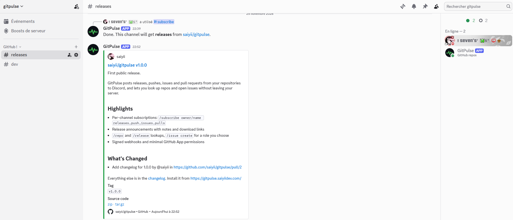
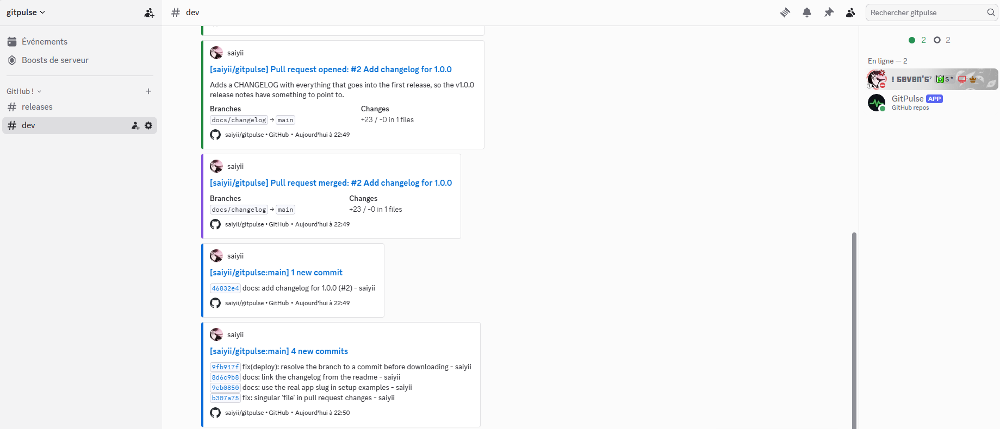
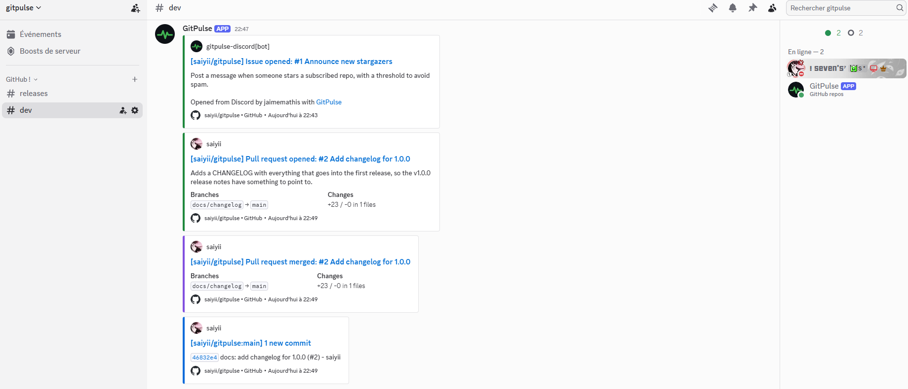
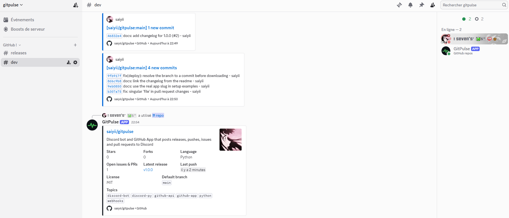

# GitPulse

[](https://github.com/saiyii/gitpulse/actions/workflows/tests.yml)
[](https://www.python.org/)
[](LICENSE)
[](https://docs.github.com/en/apps)

GitPulse is a Discord bot and GitHub App that brings your repository activity (releases,
pushes, issues, pull requests) to Discord, and lets you query repos and open issues without
leaving your server.

I wrote it because I wanted release announcements for my own projects in my Discord servers,
without handing a webhook URL with full channel access to every repo, and without polling.

## Features

- **Release announcements** with the tag, release notes (cut cleanly with a "Read more" link
  when they're long) and download links for the assets.
- **Push summaries** for the default branch: up to 5 commits with clickable short hashes,
  then "+N more". Other branches are ignored unless you turn on `PUSH_ALL_BRANCHES`.
- **Issues and pull requests**: opened, closed, reopened, merged. Colors follow GitHub's
  (green open, purple merged/completed, red closed, grey draft or not planned).
- **Slash commands** to look up a repo or its latest release, and to open an issue from
  Discord.
- **Per-channel subscriptions**: each channel picks its repos and which events it wants.
- **One process**: the bot and the webhook server share an asyncio loop, so it runs fine on
  a Pterodactyl Python egg or any box that can run `python main.py`.

<!--
## Screenshots

| Release | Push |
| --- | --- |
|  |  |
| **Pull request** | **/repo** |
|  |  |
-->

## Commands

| Command | What it does | Who can use it |
| --- | --- | --- |
| `/repo owner/name` | Description, stars, forks, language, open issues, latest release, last push | Everyone |
| `/release owner/name` | Latest release with notes and assets | Everyone |
| `/subscribe owner/name [events]` | Post the repo's activity in the current channel. `events` is a comma separated list of `releases`, `push`, `issues`, `pulls`, or `all`. Defaults to `releases` | Manage Server |
| `/unsubscribe owner/name` | Stop posting that repo in the current channel | Manage Server |
| `/subscriptions` | List what the server follows | Everyone |
| `/issue create owner/name title [body]` | Open an issue on GitHub | Members with the `ADMIN_ROLE_NAME` role, or administrators |
| `/help`, `/about` | Command list, links, support contact | Everyone |

Server admins can change who sees each command in *Server Settings → Integrations*.

## How it works

```
GitHub ── signed webhook ──▶ POST /webhook ──▶ GitPulse ──▶ subscribed Discord channels
Discord ── slash command ──▶ GitPulse ── installation token ──▶ GitHub REST API
```

GitPulse authenticates as a [GitHub App](https://docs.github.com/en/apps). It signs a short
JWT with the app's private key, trades it for an installation access token, and caches that
token until shortly before it expires. Read-only lookups on repositories where the app isn't
installed fall back to another installation's token (public data only), then to an optional
personal access token. Rate limit headers are tracked and a clear message is shown in Discord
when the limit is hit.

Webhooks only arrive for repositories where the app is installed. `/subscribe` tells you if
that's not the case yet and gives you the install link.

## Self-hosting

You need Python 3.11 or newer, a Discord bot and a GitHub App.

1. Create the GitHub App and the Discord bot: [docs/SETUP_GITHUB_APP.md](docs/SETUP_GITHUB_APP.md).
2. Clone and install:

   ```sh
   git clone https://github.com/saiyii/gitpulse.git
   cd gitpulse
   python -m venv .venv
   source .venv/bin/activate      # Windows: .venv\Scripts\activate
   pip install -r requirements.txt
   ```

3. Copy `.env.example` to `.env`, fill it in, and put the app's private key next to it as
   `private-key.pem`.
4. Run it:

   ```sh
   python main.py
   ```

5. Point the GitHub App's webhook URL at `https://your-domain/webhook`. For a real server
   behind Nginx (or on Pterodactyl), see [docs/DEPLOY_PTERODACTYL.md](docs/DEPLOY_PTERODACTYL.md).

`GET /health` returns `200 OK` once the webhook server is up.

### Testing webhooks locally

Send one of the recorded payloads to your local instance, signed with your secret:

```sh
python scripts/send_test_event.py release tests/fixtures/release_published.json
```

Subscribe a channel to `saiyii/nuclear-resource` first if you want to see it show up in
Discord. To receive real events on your machine, create a channel on [smee.io](https://smee.io),
use its URL as the app's webhook URL, and forward it:

```sh
npx smee-client --url https://smee.io/<your-channel> --target http://127.0.0.1:8080/webhook
```

## Configuration

All settings come from environment variables (or a `.env` file).

| Variable | Required | Default | Description |
| --- | --- | --- | --- |
| `DISCORD_TOKEN` | yes | | Bot token from the Discord Developer Portal |
| `DISCORD_GUILD_ID` | no | | Sync commands to this server only. Instant, handy during development |
| `GITHUB_APP_ID` | yes | | Numeric App ID from the GitHub App settings |
| `GITHUB_APP_PRIVATE_KEY_PATH` | no | `./private-key.pem` | Path to the app's private key |
| `GITHUB_WEBHOOK_SECRET` | yes | | Same secret as in the GitHub App webhook settings |
| `GITHUB_TOKEN` | no | | Personal access token used as a last resort for read-only calls |
| `WEBHOOK_HOST` | no | `0.0.0.0` | Address the webhook server binds to |
| `WEBHOOK_PORT` | no | `$SERVER_PORT` or `8080` | Port for the webhook server. Pterodactyl's `SERVER_PORT` is picked up automatically |
| `ADMIN_ROLE_NAME` | no | `Admin` | Role allowed to use `/issue create` |
| `SUPPORT_EMAIL` | no | `support@saiyiidev.com` | Shown in `/about` and in error messages |
| `PUSH_ALL_BRANCHES` | no | `false` | Announce pushes on every branch, not just the default one |
| `DATABASE_PATH` | no | `./gitpulse.db` | SQLite file for subscriptions |
| `LOG_LEVEL` | no | `INFO` | `DEBUG`, `INFO`, `WARNING`... |

## Development

```sh
pip install -r requirements-dev.txt
pytest
ruff check . && ruff format --check .
```

Tests cover webhook signature checks (including GitHub's published test vector), embed
building from recorded payloads, the REST client against a fake API, and the SQLite layer.

## Security

- Webhooks without a valid `X-Hub-Signature-256` are rejected with `401` before the body
  is parsed. Redelivered events (same `X-GitHub-Delivery`) are only handled once.
- The GitHub App only asks for: Contents (read), Metadata (read), Pull requests (read),
  Issues (read and write).
- Installation tokens live in memory and expire after an hour. The private key and `.env`
  are git-ignored.

See [SECURITY.md](SECURITY.md) to report a vulnerability.

## Support

Questions, bugs or feature requests: open an [issue](https://github.com/saiyii/gitpulse/issues)
or email **support@saiyiidev.com**.

## License

[MIT](LICENSE)

---

Built with the GitHub REST API and GitHub Apps. GitPulse is not affiliated with or endorsed
by GitHub. GitHub and the GitHub logo are trademarks of GitHub, Inc.
